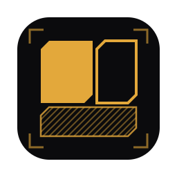

<p align="center">
  
</p>

<h1 align="center">Tessera</h1>

<p align="center">Profile-based window layouts and an app switcher for macOS, driven by hotkeys.</p>

Tessera is a menu bar app. You define slots (fractions of a named screen) and
profiles that place your apps into them. One key applies a profile. Within a
profile, an anchor app stays pinned while the switcher cycles the others
through a second slot.

## Features

- Profiles that place each app's window in a slot, picked by the connected screens.
- A switcher: `keys.switcher` + 1..N shows an app in the other slot, `F` maximizes it.
- Slot move: `keys.slotMove` + 1..N sends the focused window of any app to a slot.
- An overlay of the slots and their keys while you hold a modifier.
- Config reload on save, hotkey collision checks and keyboard-layout-aware keys.
- A `tessera` CLI (`status`, `cycle`, `push`) and a Sketchybar item.
- Open at login.

## Requirements

- macOS 15 or later
- Swift 6 toolchain (Xcode or the Command Line Tools)
- Accessibility permission, to move windows and read the overlay keys

## Install

```sh
make install IDENTITY="Your Signing Identity"
```

This builds `Tessera.app`, copies it to `~/Applications`, links the CLI to
`~/bin/tessera` and opens the app. macOS ties the Accessibility grant to the
signing identity, so use a stable one rather than an ad-hoc signature.

## Configure

Copy `config.example.json` to
`~/Library/Application Support/tessera/config.json` and edit it. The file is
JSON5, so comments and trailing commas are fine. `make check` validates it and
lists the connected screens.

## Sketchybar

`sketchybar/items/tessera.sh` and `sketchybar/plugins/tessera.sh` add a bar item
that shows the current app and profile and cycles apps on scroll.

## Development

```sh
make test   # run the TesseraCore tests
make icon   # regenerate Resources/AppIcon.icns
```

## License

[MIT](LICENSE)
